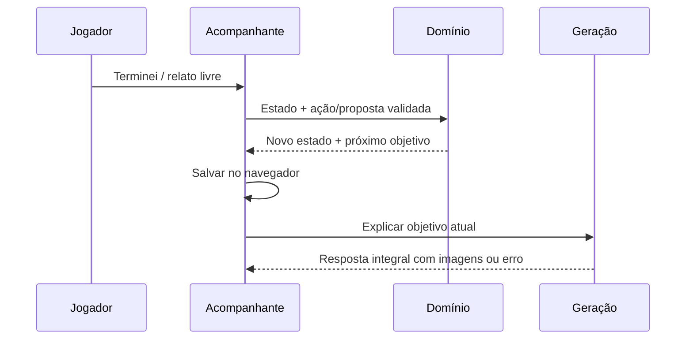

# Acompanhante: implementação local

Validado em 23/10/2026. Escopo de produto em [companion-plan.md](companion-plan.md).

## Estado e geração separados

O navegador mantém uma partida ativa. O backend valida uma proposta de mudança e
devolve o novo estado; o frontend salva esse estado antes de iniciar o job da
próxima explicação. Cancelar, falhar ou repetir a geração não desfaz nem repete a
conclusão. O botão Terminei não exige uma chamada ao modelo para registrar o fato.

## Módulos e contratos

- `companion_models.py`: contratos estritos de catálogo, partida, proposta e API.
- `companion_state.py`: catálogo e transições determinísticas, sem chamadas ao modelo.
- `companion_interpret.py`: interpretação multilíngue com JSON validado, uma correção
  limitada e evidência textual para alterações de fatos. Consultas não concluem objetivos.
- `companion_service.py`: localização dos títulos, preparação, atualização e explicação.
- `companion_api.py`: início/ações e criação de jobs; reutiliza consulta/cancelamento do chat.
- `frontend/companion.js`: convite, experiência própria, armazenamento e recuperação.
- `chat_service.py`: usa a partida compatível com o mapa e responde consultas de progresso.

API: `POST /companion/start`, `POST /companion/action`,
`POST /companion/explain/jobs`; os jobs usam `GET/DELETE /chat/jobs/{id}`.
O estado é enviado pelo cliente e validado por versão do catálogo e IDs conhecidos.
Não existe banco de partidas no servidor nesta versão.

O catálogo aproveita as fontes e relações revisadas de cada mapa com EE principal
único. As fases principais recebem números; os equipamentos são objetivos de apoio,
fora da numeração e do total das fases. `requires` orienta a navegação. `implies`
permite inferência de conclusão somente quando a relação entre fontes cobre o
procedimento completo do objetivo agrupado. Depender de uma seção de equipamento
não prova que todas as seções daquele equipamento foram concluídas.

Concluir uma fase avançada não conclui automaticamente todas as anteriores.
Pendências ou progresso parcial explícitos prevalecem sobre inferências. Caminhos
condicionais ficam identificados e podem ser confirmados pelo relato; equipamentos
opcionais não bloqueiam o término. Alterar jogadores preserva os fatos registrados
e reabre a avaliação das condições.

Correções que reabrem objetivos concluídos dependentes exigem confirmação. Consultar
uma etapa não equivale a concluí-la. A ajuda lateral preserva o retorno ao objetivo
principal. Uma dúvida específica mantém o foco; múltiplas conclusões explícitas
permitem avançar diretamente ao próximo objetivo viável.

## Experiência e persistência

O chat oferece o convite uma vez por conversa/mapa e continua respondendo normalmente.
Aceitar abre preparação curta, overview das fases e localização por texto livre.
A tela própria exibe objetivo atual, explicação com imagens, Explicar melhor,
Terminei e texto livre. Roteiro e saída ficam em controles secundários.

O histórico local posterior substituiu a partida global por um acompanhamento em
cada conversa no IndexedDB. A partida antiga de `krono.match.v1` é migrada sem
recriar mensagens que nunca foram salvas. Estado e evento da ação são gravados na
mesma transação antes da próxima geração. Explicações também ficam na transcrição
e podem ser reutilizadas na retomada quando sessão, foco e revisão correspondem.

Retomada exige o mesmo navegador/origem, sem conta ou sincronização. Limpar os
dados do site pode apagar o histórico. Mudanças incompatíveis no catálogo preservam
o registro e exigem início explícito de nova partida. Ao terminar, o modo focado
volta ao chat com o resumo registrado. Ver contratos, validação e limites em
[local-history.md](local-history.md).

A geração mantém os lotes paralelos e a entrega integral escolhidos anteriormente.
As imagens continuam ligadas aos blocos e aos grupos de locais alternativos. O
andamento acompanha as fases reais do job, com tempo decorrido e cancelamento.

## Validação e limites

- Suíte completa: **397 testes passando** (`pytest -o addopts='' -q`, embeddings
  desativados nos testes, sem chamadas pagas). Ruff e sintaxe JavaScript passaram.
- Catálogos dos dez mapas suportados, transições fora de ordem, dependências,
  evidência, perguntas sem alteração, correções, condição/jogadores, jobs e erros
  cobertos por testes automatizados.
- Navegador com resposta controlada: falha após concluir, retomada, repetição sem
  segunda conclusão, ambiguidade e confirmação de correção.
- Navegador com OpenRouter real: convite após pergunta de solo em Origins,
  preparação com dois jogadores, fases 2/3/5 concluídas com 1/4 pendentes (3/9),
  início e aprofundamento com sete imagens. Consulta no chat comum “O que falta?”
  usou a partida salva sem pedir escolha de guia ou mapa.
- Layout verificado em desktop e viewport 390 × 844, sem rolagem horizontal.

Os testes não provam precisão factual de todas as respostas nem entendimento
perfeito de qualquer relato. A interpretação ainda depende do modelo; validações
restringem efeitos, mas não substituem a revisão do jogador. Os achados semânticos
anteriores dos guias permanecem no backlog. Rótulos podem usar os títulos originais
se o provedor estiver indisponível. Atualizações das fontes podem exigir nova partida.

Todos os testes reais de modelo desta etapa usaram OpenRouter local. Chaves não
foram versionadas; nenhuma alteração foi enviada a produção. Os modos do chat foram implementados posteriormente; ver [response-modes.md](response-modes.md).
Redesign geral, PWA e desktop continuam como próximas discussões.
