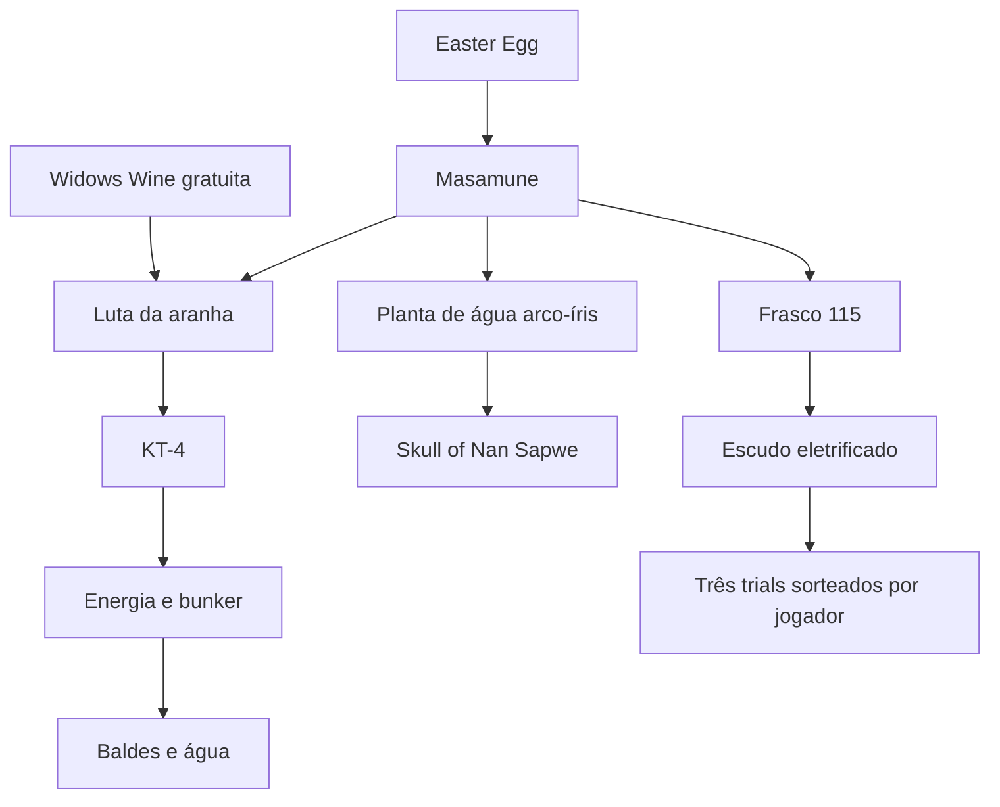

# Revisão de relações por mapa

Leitura de **166 Markdown nos 14 mapas**, concluída em 22/10/2026. Trabalho local,
sem push/deploy e sem chamadas pagas ao modelo nesta etapa. A revisão usa os
documentos do repositório; não é uma verificação externa de todos os fatos do jogo.

## Resultado

O índice passou de 30 para **196 relações**: 175 `requires`, 15 `illustrates` e
6 `recommended`. Há **192 escopos de entrada**, duas referências canônicas para
arquivos de redirecionamento e dois recortes de texto verificáveis.

O catálogo de planejamento tem 609 fontes de planejamento (incluindo dois recortes),
das quais 601 possuem cobertura de relações revisada. Os oito trechos restantes
pertencem a sete documentos lidos, mas reservados para seleção/inspeção semântica
por mistura de objetivos, descrição insuficiente ou rotas alternativas. Ler um
documento não significa certificar a completude de todas as suas receitas.

| Mapa | MD lidos | Fontes com relações revisadas / catálogo | Relações |
| --- | ---: | ---: | ---: |
| Ascension | 7 | 6 / 7 | 4 |
| Der Eisendrache | 21 | 123 / 125 | 46 |
| Gorod Krovi | 17 | 113 / 113 | 23 |
| Kino der Toten | 8 | 8 / 8 | 3 |
| Moon | 12 | 12 / 13 | 8 |
| Nacht der Untoten | 4 | 4 / 5 | 0 |
| Origins | 22 | 34 / 35 | 25 |
| Revelations | 14 | 78 / 78 | 12 |
| Shadows of Evil | 21 | 57 / 57 | 12 |
| Shangri-La | 6 | 15 / 16 | 4 |
| Shi No Numa | 4 | 6 / 6 | 1 |
| The Giant | 6 | 29 / 29 | 6 |
| Verrückt | 4 | 5 / 6 | 1 |
| Zetsubou No Shima | 20 | 111 / 111 | 51 |

Zero relações em Nacht é intencional: seus procedimentos são independentes, sem
energia/PAP nativos. Não se criou uma dependência artificial para aumentar cobertura.

Inventário e notas por mapa: `assets/guide-review.json`. Relações, citações
literais, condições, escopos, nomes de estados, recortes e fingerprints:
`assets/guide-dependencies.json`.

## Decisões preservadas no índice

- **Shadows:** EE → rituais/PAP → espada e melhoria. Shield, Civil Protector e
  Servant continuam opcionais para o EE. Servant → pods roxos/fumigador e
  bancadas. Lil Arnies melhorados precisam dos quatro rituais; isso não exige
  adicionar o ritual final de PAP. Acesso ao Rift não implica PAP completo.
- **The Giant:** Annihilator e perk extra → energia/teleportadores. Música e
  detalhes visuais permanecem independentes. A localização ilustrada dos objetos
  musicais acompanha a instrução correspondente.
- **Der Eisendrache:** arcos → Wrath of the Ancients. Rotas de foguete e
  Wunderspheres são compartilhadas quando a receita realmente as usa. A quantidade
  de arcos depende de Ranked/jogadores versus Local/Unranked. As quatro receitas
  são alternativas condicionais; não quatro pré-requisitos universais para solo.
  Plunger → somente abrir a parede do Fire + DG-4, sem a missão Fire inteira.
- **Gorod:** Gauntlet e Dragon Strike base → Hatchery/PAP. O EE também exige
  escudo base no troféu do cano, apesar de o resumo inicial colocá-lo como útil.
  As melhorias, capacetes, asas e Mark III não viraram requisitos universais.
  Aquecer o ovo com Dragon Strike é alternativa ao fogo normal. Arquivos curtos
  de upgrade apontam à receita canônica; não duplicam um roteiro de redirecionamento.
- **Zetsubou:** baldes → geradores/bunker; KT-4 → peças/construção; Masamune →
  KT-4, dente, água/planta, Skull, escudo e três trials sorteados por jogador.
  As receitas de plantas normais e fertilizadas são distintas. O trial de fruta
  usa fruta normal, sem impor KT-4. Widow's Wine grátis → só a luta da aranha e
  acesso/KT-4, sem o restante da Masamune. Spider Transformation e Golden Bucket
  são objetivos próprios, não requisitos do EE.
- **Revelations:** Keeper no primeiro reel, Arnies base nos buracos e Servant
  melhorado/PAP nos ossos. Máscaras, melhoria de Arnies e Wisp continuam opcionais.
  A peça chamada Skull of Nan Sapwe é do próprio mapa, sem importar Zetsubou.
  O Wisp depende do estágio da sala de Samantha e da elegibilidade do lobby;
  não exige executar outros mapas durante a partida.
- **Origins:** estados base/melhorado separados; preparação compartilhada e
  finalização mantidas. Pá comum/neve dá suporte ao gelo; Golden Shovel não é
  requisito. Samantha Sorrow pede quatro cajados base, não quatro upgrades.
  Drone → MagnaCollider; Ice base → método gratuito de Zombie Blood. Os métodos
  alternativos de melee do G-Strike não obrigam a construir todos os equipamentos.
- **Chronicles:** bonecas de Verrückt → música do banheiro. Reels/foguete de Kino
  → teleporte/PAP. Ascension EE → energia/PAP e contexto da rodada de macacos.
  Moon → energia/rota de volta, Hacker, PES e QED conforme o procedimento; Hacker
  e PES não são equipados ao mesmo tempo. Em Shangri-La, os gongs do esconde-
  esconde consultam somente localizações, sem exigir Fractalizer ou o EE inteiro.

Um exemplo da separação de escopos em Zetsubou:

As setas mostram requisitos do procedimento. Obter o perk gratuito não exige
percorrer os outros ramos da Masamune.

## Funcionamento e limites

Uma condição acompanha a cadeia transitiva. Se o mesmo equipamento for necessário
por duas rotas, as condições são alternativas (`OR`); se também existir uma rota
incondicional, o requisito compartilhado passa a ser incondicional. Concluir uma
receita condicional não implica concluir todas as variantes/objetivos associados.

`recommended` registra a relação opcional, mas o resolvedor não expande essas
receitas automaticamente. O texto canônico informa o equipamento útil; quando
explicitamente solicitado, sua própria receita pode ser selecionada. `illustrates`
anexa contexto/fotos sem declarar que a missão de origem precisa ser completada.

Enciclopédias de plantas, máscaras, pods, pás e overviews não são um objetivo
único. Sem um estado nomeado inequívoco, a seleção semântica ainda escolhe os
trechos pertinentes; as dependências revisadas são expandidas localmente depois.
Isso pode envolver uma chamada de seleção, mas não exige redescobrir relações
já revisadas. Nomes como Tiamat, Goddard e os estados melhorados dos cajados
selecionam seus escopos próprios; um pedido com vários nomes pode usar o seletor.

Os dois recortes guardam pai, fingerprint, citações inicial/final e imagens
permitidas. O texto é um intervalo literal do original. A pá comum mantém apenas
as seis fotos de pá/escavação/neve; não as três de upgrades dourados/red digs.
Os gongs mantêm suas oito fotos de localização, recuperadas na revisão editorial,
sem herdar etapas de dinamite nem fotos da conclusão do EE. Alterações
no pai invalidam o recorte, sem atualização cega de hashes.

Na ampliação original, Markdown, manifesto de imagens e índice vetorial não foram
alterados. A revisão editorial posterior atualizou os três; detalhes em
[correções das fontes](source-corrections.md). Os recortes
existem somente no catálogo de planejamento e preservam o caminho/proveniência.
O servidor continua com geração sequencial; auditoria desligada; desenvolvimento
usa OpenRouter. Streaming, paralelismo padrão, modos e frontend ficam para as
etapas combinadas.

## Lacunas encontradas nas fontes — registro anterior à correção

**Situação atual:** os bloqueios abaixo foram tratados na revisão editorial de
22/10; veja [resoluções e limites remanescentes](source-corrections.md). Os relatos
a seguir preservam o diagnóstico original, não descrevem todos o estado atual.

Esses achados estão documentados e em notas de interpretação quando pertinentes;
não foram preenchidos com memória do jogo nem tratados como correções factuais.
A seleção local ainda pode produzir uma resposta estruturada; o grafo não corrige
essas lacunas textuais nem certifica que a explicação gerada será completa.

1. **Shangri-La:** o EE pula do passo 2 para o 7; faltam 3–6. As imagens estão
   agrupadas de forma desigual nos passos posteriores. O roteiro não pode ser
   certificado completo com essa base.
2. **Origins:** G-Strike menciona colocar a pedra de volta e novas mortes sem
   explicar o retorno; música 3 fala em três números, mas nomeia só 1 e 5; a
   frase do cristal de fogo está corrompida. Notas evitam inventar Juggernog como
   pré-requisito e reforçam as ações existentes, sem inventar a informação ausente.
3. **Der Eisendrache:** falta a posição exata do DG-4 para Plunger e uma receita
   explícita de ativação da antigravidade. O Fire mistura referências de lareira
   com nomes inconsistentes. Free Mega tem duas rotas de viagem no tempo, por isso
   sua seleção não foi fixada como se ambas fossem obrigatórias.
4. **Zetsubou:** buckets não têm todos os locais transcritos; Golden Bucket não
   define quais variantes contam como "major plant type"; locais mesmerize ficam
   principalmente nas imagens. Overview de trials afirma 16, mas enumera quinze.
   A afirmação da máscara de gás como barreira absoluta ao boss precisa de revisão
   factual separada; a relação atual segue os requisitos declarados pelo guia.
5. **Verrückt:** um local da boneca no manequim termina no meio da frase.
6. **Conquistas:** arquivos de Ascension, Moon, Shangri-La e Origins misturam
   objetivos; Nacht/Verrückt têm descrições insuficientes. Moon referencia uma
   entrada de One Giant Leap que não aparece como conquista separada no arquivo.

## Validação e sequência

`python -m scripts.validate_dependencies` verifica IDs/fingerprints, evidência
literal, mesmo mapa, aliases, nomes de estados, recortes, ciclos e ordem dos 192
escopos. O maior plano local possui 69 fontes (DE), abaixo do teto atual de 96.
Testes independentes conferem inclusões/exclusões, estados base/upgrade, condições,
imagens e os dez EEs preparados sem chamada ao modelo para planejamento.

Na etapa original de relações, a suíte passou com **332 testes e 91,97% de cobertura**, acima do piso de
90%; lint e `git diff --check` aprovados. São 38 testes adicionais nesta etapa,
incluindo regressão da compactação transitiva de energia/teleporte no pedido
"e os arcos?". As expectativas antigas de fotos/fontes foram atualizadas para
incluir bancadas de Shadows e apenas o recorte normal de pá de Origins.

Servidor local reiniciado com saúde OK, embeddings prontos e zero erros de
validação. Não há medição nova da geração real nem alegação de equivalência
semântica das respostas. Próxima etapa: repetir a comparação única/sequencial/
paralela com esta versão das relações e revisar os textos antes da escolha da
arquitetura. Sem push ou deploy.

## Revisão editorial posterior

As correções recuperaram os passos ausentes e suas imagens, explicitaram as rotas
truncadas e atualizaram relações, fingerprints e embeddings. O catálogo base tem
607 chunks; o catálogo de planejamento tem 609 fontes. Três cheatsheets deixaram
de ser tratadas como fases executáveis. Há seis novas relações para a receita
compartilhada de antigravidade; Golden Bucket passou a exigir as quatro receitas
ordinárias, sem anexar a enciclopédia inteira de plantas.

A certificação factual continua limitada aos pontos pesquisados. Oito trechos
continuam fora da cobertura determinística por seleção de objetivos/rotas; isso
não significa que as frases antes truncadas ainda estejam truncadas.

Resultados da validação editorial mais recente, incluindo reexecução das três
expectativas de teste atualizadas: [source-corrections.md](source-corrections.md).
